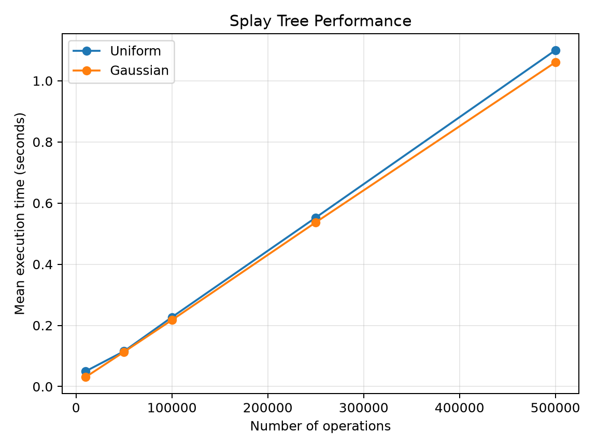

# Splay Tree Implementation

A C++ implementation of a **Splay Tree**, developed as a Data Structures course project, with a Python-based performance evaluation using uniform and Gaussian input distributions.

## Implementation

A Splay Tree is a self-adjusting binary search tree that moves accessed nodes toward the root through rotations. The implementation includes **Zig**, **Zig-Zig**, and **Zig-Zag** rotations and supports the following operations:

- `add x` — insert an integer if it is not already present.
- `del x` — remove an integer if it exists.
- `find x` — check whether an integer exists.
- `sum l r` — calculate the sum of stored integers in the inclusive range `[l, r]`.

## Performance Evaluation

The Python benchmark generates rounded integer values using two distributions:

- **Uniform:** values sampled between 1 and 100.
- **Gaussian:** mean 50 and variance 25 (standard deviation 5).

Tests use 10,000, 50,000, 100,000, 250,000, and 500,000 operations, with three runs per configuration. The benchmark records execution times and plots the mean time for each distribution.

The measured total execution time increases approximately linearly with the number of operations for these workloads. Gaussian workloads were slightly faster in the recorded runs. Since sampled values are rounded and drawn from narrow distributions, the number of distinct stored keys remains relatively small; these results describe the tested workloads rather than general asymptotic performance.
